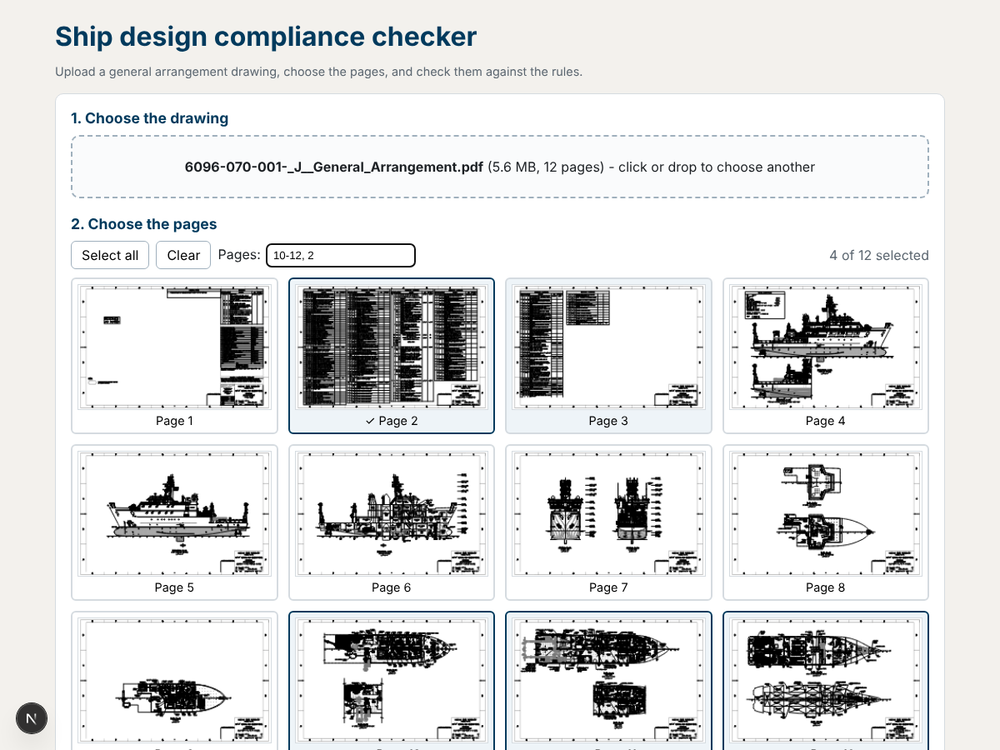
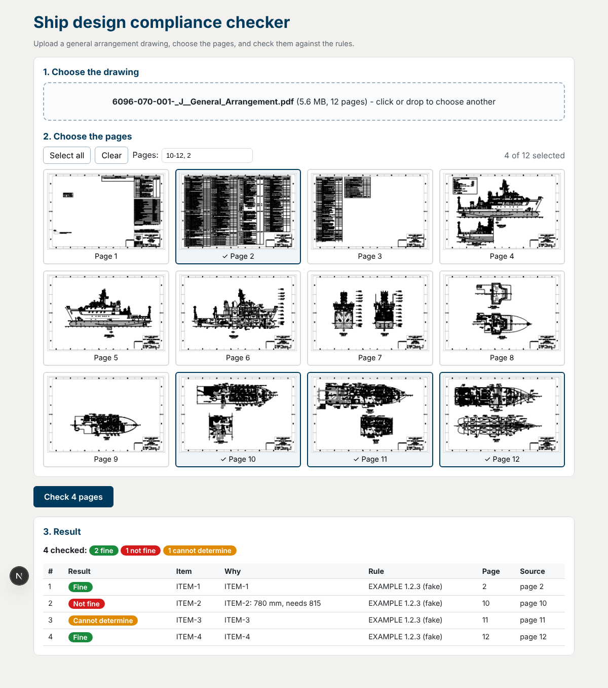

# Ship design compliance checker

A Next.js App Router website for uploading a general arrangement PDF, choosing pages, and checking them against compliance rules.

## Run locally

Requires Node.js 20 or newer.

```powershell
npm install
Copy-Item .env.example .env.local
npm run dev
```

Open [http://localhost:3000](http://localhost:3000). The example environment enables mock results so the interface can be tried without a backend. Restart the dev server after changing `.env.local`.

To use the Python backend instead, set `NEXT_PUBLIC_MOCK=0` and configure `NEXT_PUBLIC_API_URL` (defaults to `http://localhost:8000`).

## Project files

- `src/app/page.js` — upload, page selection, and check workflow.
- `src/components/PdfPicker.js` — PDF upload, page previews, and page selection.
- `src/components/ResultsView.js` — summary, marked drawings, and findings table.
- `src/lib/pdf.js` — browser-side PDF rendering and page-range helpers.
- `src/lib/api.js` — backend request and mock results.
- `scripts/copy-pdf-worker.mjs` — copies the PDF.js worker into `public/` during install.
- `public/picker_preview.png` and `public/result_preview.png` — supplied design references.

## Backend contract

The website sends `POST {NEXT_PUBLIC_API_URL}/check` as multipart form data with `file` (the PDF) and `pages` (comma-separated, 1-based page numbers). The response JSON has this shape:

```json
{
  "summary": { "checked": 5, "fine": 3, "not_fine": 1, "unknown": 1 },
  "findings": [
    {
      "number": 1,
      "rule": "...",
      "clause": "ADA 404.2.3",
      "item": "D-214",
      "verdict": "not_fine",
      "label": "D-214: 780 mm, needs 815",
      "page": 1,
      "source": "GA drawing page 1"
    }
  ],
  "images": [{ "page": 1, "url": "/files/report_page1.png" }]
}
```

`verdict` is `fine`, `not_fine`, or `unknown`. The backend must allow requests from the website through CORS. Page previews are rendered in the browser; the PDF is sent only after pressing **Check**.

## Design references




